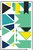

# Edugates International School — Math-Science Team
## Interactive Smartboard Math & Logic Puzzle Lab

<p align="center">
  
</p>

Welcome to the **Edugates International School — Math-Science Team** Interactive Puzzle Lab! This repository contains **41 mathematical, geometric, graph-theory, and deductive logic puzzles** compiled to high-efficiency WebAssembly and specifically engineered to run **smoothly in web browsers on low-processor classroom Smartboards**.

---

## Key Features for Classroom Smartboards

### 1. Low-Processor Smartboard Engine (`1.0x DPR` & Zero GPU Bloat)
- **1.0x Native Pixel Ratio Cap (`window.__EDUGATES_DPR__ = 1`)**: Classroom 4K/Retina interactive flat panels (IFPs) with modest ARM/Celeron processors often struggle with 4x pixel fill rates. The engine defaults to `1.0x` native canvas resolution (saving up to **75% pixel fill rate**), with a one-tap **1x Low-CPU / HD** toggle in the top toolbar.
- **Zero Expensive Compositor Effects**: All CSS `backdrop-filter`, `box-shadow` blurs, `shadowBlur`, and continuous background animations are eliminated so the browser compositor only repaints dirty rectangles when a student touches the board.
- **Integer-Clamped Dirty-Rect Blitting**: Offscreen-to-onscreen canvas blits in `_js_canvas_end_draw` use cached 2D contexts and integer-clamped coordinates to prevent sub-pixel interpolation overhead.

### 2. Full Smartboard Touch & Multi-Mode Interaction
- **Direct Touch & Drag**: Full `touchstart`, `touchmove`, and `touchend` support with `touch-action: none` on the puzzle canvas so dragging bridges, loops, or slants never scrolls or zooms the browser page.
- **One-Tap Left / Right / Middle Click Mode Switcher**: Smartboard pens and single-finger touches normally only emit left clicks. The floating dock provides large, touch-friendly **Primary Action (Left Click)**, **Secondary / Mark (Right Click)**, and **Middle / Lock** mode toggles, plus two-finger tap right-click support.
- **Context-Aware Touch Keypad & D-Pad**: Numeric puzzles (`Towers`, `Solo`, `Keen`, `Unequal`, `Range`, `Filling`, `Signpost`, `Bridges`) and Group Theory (`Group`) automatically display large on-screen number/letter buttons and directional arrow keys.

### 3. Classroom Teaching Tools
- **Smartboard Annotation Pen (`✏️ Board Pen`)**: Draw directly over any puzzle in Yellow, Cyan, Red, or Green to explain deductive steps to the class without altering the underlying puzzle state.
- **Auto-Fit Board Scaling & Zoom (`−` / `Fit` / `+`)**: Automatically scales every puzzle canvas to fit the classroom display, with instant manual zoom controls.
- **Dark Board & Light Board Themes**: High-contrast **Dark Board** mode (reduces glare on projector/LED panels) and **Light Board** mode (ideal for brightly lit classrooms).
- **Offline PWA Support**: Includes `manifest.json` and Service Worker (`sw.js`) so puzzles remain playable even if classroom Wi-Fi drops.

---

## Included Puzzles (All 41 Games)

### Featured Classroom Classics
- **[Bridges](bridges.html)** — Connect islands with horizontal and vertical bridges matching each island's degree.
- **[Towers](towers.html)** — 3D Latin square skyscraper visibility puzzle.
- **[Light Up](lightup.html)** — Place lamps to illuminate every corridor without shining on another lamp.
- **[Slant](slant.html)** — Draw diagonal lines in every cell matching vertex degree clues without forming loops.
- **[Net](net.html)** — Rotate network tiles to connect all terminals into a single spanning tree.
- **[Slitherlink / Loopy](slither.html)** ([loopy.html](loopy.html)) — Form a single continuous loop around numbered cells.

### Complete 41-Puzzle Collection
| Category | Puzzles |
| :--- | :--- |
| **Numbers & Latin Squares** | [Towers](towers.html), [Solo (Sudoku)](solo.html), [Keen (KenKen)](keen.html), [Unequal (Futoshiki)](unequal.html), [Group (Cayley Tables)](group.html), [Signpost](signpost.html), [Singles (Hitori)](singles.html), [Range (Kuromasu)](range.html), [Filling](filling.html) |
| **Loops, Networks & Graphs** | [Bridges](bridges.html), [Slitherlink / Loopy](slither.html), [Slant](slant.html), [Net](net.html), [Netslide](netslide.html), [Pearl (Masyu)](pearl.html), [Tracks](tracks.html), [Untangle (Planar Graphs)](untangle.html), [Palisade](palisade.html) |
| **Grid Deduction** | [Light Up](lightup.html), [Pattern (Nonograms)](pattern.html), [Galaxies](galaxies.html), [Tents](tents.html), [Dominosa](dominosa.html), [Magnets](magnets.html), [Mines](mines.html), [Mosaic](mosaic.html), [Rectangles (Shikaku)](rect.html), [Unruly](unruly.html), [Undead](undead.html), [Map (Four-Color Theorem)](map.html), [Black Box](blackbox.html), [Guess (Mastermind)](guess.html) |
| **Spatial & Movement** | [Fifteen](fifteen.html), [Sixteen](sixteen.html), [Twiddle](twiddle.html), [Cube](cube.html), [Flip](flip.html), [Flood](flood.html), [Inertia](inertia.html), [Pegs](pegs.html), [Same Game](samegame.html) |

---

## Running Locally or on a Smartboard

1. **GitHub Pages / Static Hosting**: Serve the repository root directory directly. Open `index.html` in any modern web browser.
2. **Local Classroom Server**:
   ```bash
   python3 -m http.server 8080
   ```
   Then open `http://localhost:8080` on the Smartboard browser.

---

## Credits & License

- **Branding & Smartboard Optimization**: **Edugates International School — Math-Science Team**
- **Original Puzzle Collection**: Adapted from [Simon Tatham's Portable Puzzle Collection](https://www.chiark.greenend.org.uk/~sgtatham/puzzles/) and [Chris Boyle's sgtpuzzles](https://github.com/chrisboyle/sgtpuzzles) under the [MIT License](doc/licence.html).
